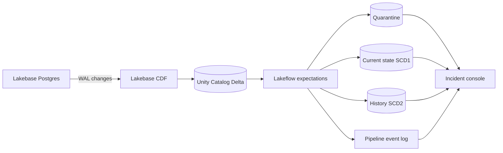

# Faultline

Faultline is a fault-injected change-data-capture reliability lab for Databricks. It is designed to answer a practical question: when operational data arrives twice, late, malformed, out of order, or after a schema change, can the lakehouse recover to a provably correct state?


The finished system will connect Lakebase Postgres, Lakebase Change Data Feed, Unity Catalog, Lakeflow Declarative Pipelines, and a Databricks App. The repository starts with a deterministic local core so the reconciliation and fault-handling logic can be tested without a cloud workspace.

## Current milestone

The local engine implements:

- deterministic CDC event generation;
- duplicate, corruption, and out-of-order fault injection;
- idempotent projection into current state;
- invalid-event quarantine;
- deterministic replay and reconciliation invariants; and
- a command-line report suitable for regression and benchmark runs.

The repository also contains a deployed Lakeflow pipeline, Declarative
Automation Bundle, Lakebase project, and read-only Databricks App incident
console. The next milestone is a larger fault matrix and recorded public demo.

The reference workspace runs a Lakebase-CDF-compatible Delta fallback because
Free Edition uses Databricks default catalog storage, while native Lakebase CDF
currently requires an external-storage-backed catalog. The real Lakebase
database remains deployed and exercised; the fallback preserves the documented
CDF columns and all downstream semantics without overstating preview support.

## Run locally

```powershell
python -m pip install -e .
faultline simulate --entities 100 --duplicate-every 7 --corrupt-every 11 --reverse-window 5
python -m unittest discover -s tests -v
```

The simulator exits successfully only when the projected current state matches an independent replay of every accepted unique event.

## Deploy to Databricks

Prerequisites are a Unity Catalog-enabled workspace, serverless pipeline access,
and a Lakebase Change Data Feed whose destination table follows the documented
`lb_orders_history` schema. Authenticate with OAuth, then validate and deploy:

```powershell
databricks auth login --host https://<your-workspace-host>
databricks bundle validate -t dev
databricks bundle deploy -t dev
databricks bundle run faultline_cdc -t dev
```

Override `catalog`, `source_schema`, or `target_schema` with `--var` when your
workspace names differ from the defaults. The source table name is derived
from the deployed raw-schema resource so development prefixes remain correct.
No credentials or workspace URLs belong in this repository.

For a fallback workspace, seed and verify the exact CDF-compatible contract:

```powershell
python -m pip install -e ".[databricks]"
python scripts/seed_delta_cdf.py --warehouse-id <warehouse-id> --schema <raw-schema>
python scripts/verify_workspace.py --warehouse-id <warehouse-id> --schema <target-schema>
```

## Verified workspace result

On October 29, 2026, the development bundle completed successfully in a
Databricks Free Edition workspace. The automated verifier confirmed:

- 8 received rows and 7 distinct source events;
- 1 exact duplicate detected;
- 1 malformed order quarantined with `valid_order_values` as the reason;
- 6 valid actionable rows and 4 SCD Type 2 history rows;
- 2 final current-state orders after update and delete semantics; and
- a successful Lakeflow update with every flow completed.

The incident console runs as an authenticated Databricks App. Its service
principal receives `CAN_USE` on one SQL warehouse and `SELECT` on only the four
tables it displays.

## Target architecture



1. An operational order service writes inserts, updates, and deletes to Lakebase Postgres.
2. Lakebase Change Data Feed copies WAL changes into a Unity Catalog Delta table.
3. Lakeflow builds raw, validated, quarantined, current-state, history, and reliability datasets.
4. A fault harness injects duplicates, malformed values, delayed events, concurrent updates, deletes, and schema changes.
5. A Databricks App visualizes data freshness, expectation failures, reconciliation errors, recovery time, and replay outcomes.
6. A Declarative Automation Bundle defines the app, pipeline, jobs, tests, and deployment configuration.

## Design principles

- **Correctness before UI:** state is derived from replayable events and checked with explicit invariants.
- **Idempotency by default:** retries and duplicate delivery must not change results.
- **Invalid data remains inspectable:** malformed events are quarantined instead of silently discarded.
- **Local-first testing:** core logic runs without Databricks; platform adapters remain thin.
- **Measurable reliability:** benchmarks will report throughput, validation overhead, duplicate suppression, recovery time, and reconciliation accuracy.

## Status

Faultline is under active development. Metrics and deployment claims will be added only after they are measured against a Databricks workspace.

