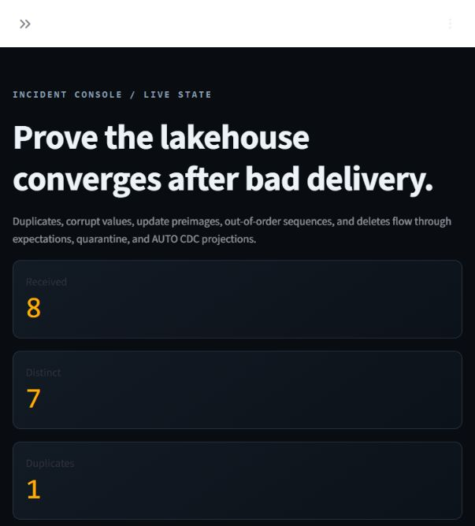
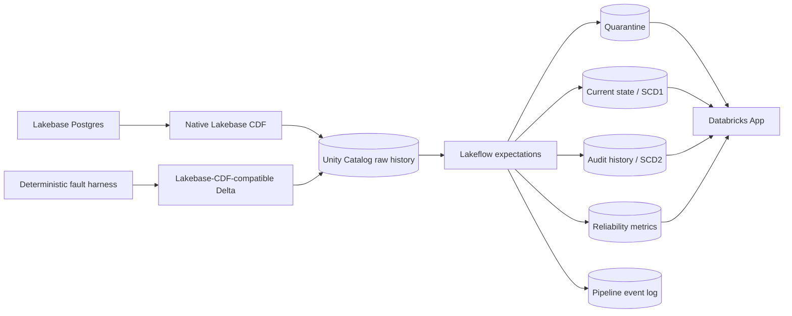

# Faultline

[](https://github.com/raaidiqbal/faultline-dbx/actions/workflows/ci.yml)
[](https://github.com/raaidiqbal/faultline-dbx/actions/workflows/codeql.yml)
[](https://www.python.org/)
[](LICENSE)

Faultline is a fault-injected change-data-capture reliability lab for Databricks. It answers one concrete systems question: when operational changes arrive twice, late, malformed, out of order, or as deletes, can the lakehouse still converge to a provably correct state?



## Engineering evidence

This is a deployed end-to-end system, not a notebook mockup.

- **Design:** explicit CDC ordering, idempotency, quarantine, tombstone, and replay invariants.
- **Development:** dependency-free Python correctness oracle plus thin Databricks adapters.
- **Testing:** 20 deterministic tests across Python 3.11 and 3.13, seeded arrival-order property checks, platform-contract tests, and an automated workspace verifier.
- **Delivery:** Declarative Automation Bundle owns Lakebase, Unity Catalog schemas, Lakeflow, and the Databricks App.
- **Operations:** pipeline event log, expectations, reliability counters, SCD1 current state, SCD2 history, and a read-only incident console.
- **Security:** OAuth instead of embedded tokens; the app receives `CAN_USE` on one warehouse and `SELECT` on only four tables.

The project is deliberately shaped like a small platform feature: architecture, implementation, tests, deployment, observability, failure handling, and an honest production-readiness boundary all live in one repository.

## Run locally

```powershell
python -m pip install -e .
faultline simulate --entities 100 --duplicate-every 7 --corrupt-every 11 --reverse-window 5
python -m unittest discover -s tests -v
```

The simulator exits successfully only when the projected current state matches an independent replay of every accepted unique event.

To reproduce the checked-in benchmark:

```powershell
python scripts/benchmark_local.py --repeats 7 --output benchmarks/local-2026-10-29.json
```

## Deploy to Databricks

Prerequisites are a Unity Catalog-enabled workspace, serverless pipeline access,
and a Lakebase Change Data Feed whose destination table follows the documented
`lb_orders_history` schema. Authenticate with OAuth, then validate and deploy:

```powershell
databricks auth login --host https://<your-workspace-host>
databricks bundle validate -t dev
databricks bundle deploy -t dev
databricks bundle run faultline_cdc -t dev
databricks bundle run faultline_console -t dev
```

Override `catalog`, `source_schema`, or `target_schema` with `--var` when your
workspace names differ from the defaults. The source table name is derived
from the deployed raw-schema resource so development prefixes remain correct.
No credentials or workspace URLs belong in this repository.

For a fallback workspace, seed and verify the exact CDF-compatible contract:

```powershell
python -m pip install -e ".[databricks]"
python scripts/seed_delta_cdf.py --warehouse-id <warehouse-id> --schema <raw-schema>
python scripts/verify_workspace.py --warehouse-id <warehouse-id> --schema <target-schema>
```

## Verified workspace result

On October 29, 2026, the development bundle completed successfully in a
Databricks Free Edition workspace. The automated verifier confirmed:

- 8 received rows and 7 distinct source events;
- 1 exact duplicate detected;
- 1 malformed order quarantined with `valid_order_values` as the reason;
- 6 valid actionable rows and 4 SCD Type 2 history rows;
- 2 final current-state orders after update and delete semantics; and
- a successful Lakeflow update with every flow completed.

The incident console runs as an authenticated Databricks App. Its service
principal receives `CAN_USE` on one SQL warehouse and `SELECT` on only the four
tables it displays.

The local correctness oracle also reconciled every scenario in a seven-run fault matrix. Its largest case delivered 31,500 events with 10,500 duplicates and 1,539 quarantined events; p95 ingest-plus-independent-replay time was 231.957 ms on the development machine. These are local algorithm measurements, not Databricks cluster throughput or SLA claims. Raw measurements live in [`benchmarks/local-2026-10-29.json`](benchmarks/local-2026-10-29.json).

## Architecture



Two input modes share the same documented Lakebase CDF row contract:

1. **Native mode:** Lakebase WAL changes land in a Unity Catalog Delta history table.
2. **Fallback mode:** the deterministic harness writes the same system columns (`_pg_change_type`, `_pg_lsn`, `_pg_xid`, `_timestamp`, and `_sort_by`) directly to Delta.

The verified Free Edition deployment uses fallback mode because native Lakebase CDF rejected its default-storage catalog and required an external-storage-backed catalog. The Lakebase Postgres project is still deployed and exercised. The UI and README label the fallback explicitly rather than presenting preview behavior as verified.

## Reliability contract

Faultline treats correctness as executable behavior:

- an event identity is `(LSN, transaction ID, entity ID)`;
- exact retries cannot change projected state;
- current state is selected by source order, not arrival order;
- a late update cannot resurrect a more recent delete;
- invalid actionable events remain inspectable in quarantine;
- update preimages remain in bronze for audit but never overwrite current state;
- SCD1 and SCD2 projections use Lakeflow `AUTO CDC` with `_sort_by` ordering; and
- an independent replay must exactly match every accepted unique event.

## Repository map

```text
app/                         Read-only Streamlit incident console
databricks/pipelines/        Lakeflow Declarative Pipeline
databricks/sql/              Lakebase and Delta fallback setup
resources/                   Bundle resources for app, pipeline, schemas, Lakebase
scripts/                     Seed, benchmark, and workspace verification tools
src/faultline/               Platform-independent CDC correctness oracle
tests/                       Unit and platform-contract tests
slopdocs/                    Dense engineering plans and feature decisions
```

## Trade-offs and next experiments

- Databricks Apps require workspace authentication, so the public recruiter artifact is this repository and captured demo—not the live URL.
- The checked-in fault matrix measures the local oracle. A paid or external-storage workspace is required to benchmark native Lakebase CDF end to end.
- The next useful experiments are sustained-load recovery timing, schema-evolution scenarios, and a recorded 90-second failure/replay demonstration.

## Primary references

- [Lakebase Change Data Feed](https://docs.databricks.com/aws/en/oltp/projects/lakebase-cdf)
- [Lakeflow AUTO CDC](https://docs.databricks.com/aws/en/ldp/cdc)
- [Lakeflow expectations](https://docs.databricks.com/aws/en/ldp/expectations)
- [Declarative Automation Bundles](https://docs.databricks.com/aws/en/dev-tools/bundles/)
- [Databricks Apps resources and authorization](https://docs.databricks.com/aws/en/dev-tools/databricks-apps/resources)

## License

[MIT](LICENSE)

